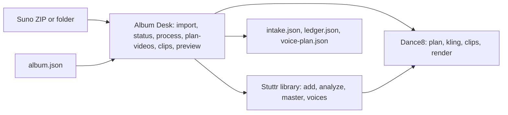

# Stuttr Album Desk

A whole Suno album in one command, then only the exceptions. The desk is a
thin layer over the song library and Dance8: every song still goes through the
same code as `stuttr add`, `analyze`, `master`, `voices`, `dance8 plan`,
`kling`, `clips` and `render`. Code: `lib/stuttr/desk/`; tests:
`tests/stuttrDesk.test.ts`; baseline: [`album-desk/BASELINE.md`](album-desk/BASELINE.md).

**Not connected yet:** the Suno MCP connector (manual ZIP export is the path),
any Kling API (the manual pack is the path), and Kirtled performance mode
(D8-08, not built). ElevenLabs is reached only by the existing `convert` code,
only through a reviewed plan with a credit cap.

## The three steps

1. **Drop the album.** In Suno, select the songs, right-click, Download All
   (WAV if your plan offers it), and Multitrack stems for any song you want
   converted. Put the ZIP and your `album.json` in one folder, then:

   ```
   npm run stuttr -- album-import ~/StuttrInbox/_drop/Album.zip --manifest ~/StuttrInbox/_drop/album.json --dry-run
   npm run stuttr -- album-import ~/StuttrInbox/_drop/Album.zip --manifest ~/StuttrInbox/_drop/album.json
   ```

   No manifest yet? Run it without `--manifest`: it writes a starter
   (`~/StuttrLibrary/_albums/<album>/album.starter.json`) from what it found
   and imports nothing. Edit it and save it as your `album.json`.

2. **Clear the exceptions.** `npm run stuttr -- album-status <album>` shows
   every track's state, what holds it and the next command. `--html` also
   writes a plain page beside the records. The free steps:

   ```
   npm run stuttr -- album-process <album> --stage audio     (analysis; Suno-vocals masters)
   npm run stuttr -- album-plan-videos <album>               (cue maps, shot lists, Kling packs)
   npm run stuttr -- album-resume <album>                    (both, whichever are due)
   ```

   Converted voices are paid, so they take two runs: the first shows the plan
   and its hash, the second runs exactly that plan under a cap:

   ```
   npm run stuttr -- album-process <album> --stage voices
   npm run stuttr -- album-process <album> --stage voices --approved-plan <hash> --max-credits <n>
   ```

3. **Bring the clips back and preview.** Generate each pack's shots in Kling,
   save each download as its shot id in one folder per track id
   (`~/Downloads/<album>/<trackId>/<shotId>.mp4`), then:

   ```
   npm run stuttr -- album-clips <album> ~/Downloads/<album>
   npm run dance8 -- approve-clip <trackId> <clipId> --drift 0.1      (your check, per clip)
   npm run stuttr -- album-preview <album>                            (local draft renders)
   ```

   Listening, approving masters and clips, and the final render stay yours
   (`npm run stuttr -- approve-master <id> --suno`, `npm run dance8 -- render <id> --approved`).

Every command also answers to the spaced form (`album import`, `album status`,
...), and `--help` prints them all. The older per-song and album commands are
unchanged.

## The manifest (`album.json`)

```json
{
  "schemaVersion": "stuttr-album-manifest-1",
  "albumId": "synthetic-desk",
  "title": "Synthetic Desk Album",
  "sunoPlan": "Pro",
  "rights": { "state": "UNKNOWN" },
  "tracks": [
    { "trackNumber": 1, "title": "Pulse Song", "performers": ["Performer Mid"], "voiceStrategy": "KEEP_ORIGINAL" },
    { "trackNumber": 2, "title": "Voice Song", "performers": ["Performer Low"], "voiceStrategy": "CONVERT_APPROVED_SEGMENTS", "mode": "solo" },
    { "trackNumber": 3, "title": "Eighteen", "source": "Album/Eighteen v2" }
  ]
}
```

- `rights.state`: `UNKNOWN` (default), `PERSONAL_USE_ONLY` or `CLEARED`. Until
  it is `CLEARED`, everything stays a local draft (STU-02).
- `voiceStrategy`: `KEEP_ORIGINAL` (default: Suno's vocals),
  `CONVERT_APPROVED_SEGMENTS` (with `mode` solo, crew or cast) or
  `MANUAL_SPLIT_REQUIRED`.
- `performers`: fictional roles, never inferred from the audio.
- `source`: pins a track to a folder or file in the drop, exactly as the import
  report prints it. It is how you confirm a suggested match. JSON only: YAML
  would need a new parser.

## The voice map (private)

`~/StuttrLibrary/voice-map.private.json`, never in git:

```json
{ "schemaVersion": "stuttr-voice-map-1",
  "voices": [ { "performer": "Performer Low", "voice": "Voice name in your ElevenLabs account", "consent": "my own synthetic voice", "approved": true } ] }
```

Names only. A voice id is refused. A converted song waits until every voice
it uses is here and approved.

## What it checks

| Stage | Check | Outcome |
|---|---|---|
| Drop | ZIP paths (Zip Slip, absolute, backslash), symlinks, encryption, ZIP64, names equal once Unicode and case are ignored, unpack ratio, total size, CRC of every entry | The whole drop is refused, nothing unpacked |
| Drop | Real codec, rate, channels, length and peak (ffprobe, ffmpeg), not the extension | `CORRUPT_MEDIA`, `EXTENSION_MISMATCH`, `CLIPPING_RISK` |
| Match | Pinned source, Suno id in a file name, or the same title as a slug; near titles are suggestions only | `MATCH_REVIEW`, `MISSING_SOURCE`, `UNLISTED_SOURCE`, `VARIANT_TAKES` |
| Audio | WAV over MP3 of the same part; two lengths means two edits | `LOSSY_DUPLICATE` (info), `DIFFERENT_EDITS`, `LOSSY_SOURCE` |
| Audio | Each stem's offset against the full mix by cross-correlation (8 kHz, samples and ms); untrusted peaks are unknown, never zero | `STEM_OFFSET`, `ALIGNMENT_UNKNOWN`, `STEM_LENGTH`, `MISSING_FULL_MIX` |
| Voices | Lead stem present; one performer per stem unless the mode is cast; voice map; provider key present (by name only) | `MISSING_STEMS`, `OVERLAP_REQUIRES_SPLIT`, `NO_VOICE_MAP`, `VOICE_NOT_APPROVED`, `PROVIDER_UNAVAILABLE` |
| Paid calls | Plan hash and credit cap; a timeout or 5xx after the call is ambiguous and is never resent on its own | `AMBIGUOUS_SUBMISSION` until `album-resolve` |
| Video | Clip length against its shot, shape (never stretched), constant standard frame rate | `CLIP_TOO_SHORT`, `ASPECT_MISMATCH`, `VARIABLE_FRAME_RATE`, `FPS_NONSTANDARD` |
| Render | One audio stream, the master the manifest names, the planned length, the right shape | Findings beside the draft |

A hold stops its own track and stage only: a song waiting on a voice still
gets its cue map, and a held song never stops the others.

## Track states

Worked out from the files every time, never stored:

`WAITING_SOURCE` → `DISCOVERED` → `MATCHED` → `STAGED` → `AUDIO_QA` →
`AUDIO_APPROVED` → `CUES_VALIDATED` → `SHOTS_PREPARED` →
`CLIPS_IMPORT_PENDING` → `CLIPS_QA` → `RENDER_ELIGIBLE` → `DRAFT_RENDERED`.

## Where things live

Storage is **provisional**: canon STU-04 (where Stuttr assets live, and the
rights chain) is open, so the desk keeps its records beside the library you
already use, outside git:

| Path | Holds |
|---|---|
| your drop (ZIP or folder) | Read only; hashed before and after |
| `~/StuttrLibrary/<trackId>/source/` | The library's copy of each song's files (as `stuttr add`), checked byte for byte against the drop |
| `~/StuttrLibrary/_albums/<album>/intake.json` | What each import found: files, hashes, probes, offsets, issues, clip QA |
| `~/StuttrLibrary/_albums/<album>/ledger.json` | Every job: key, inputs (hashes), status, attempts, estimated units |
| `~/StuttrLibrary/_albums/<album>/voice-plan.json` | The last voice plan, its credits and hash |
| `~/StuttrLibrary/_intake/` | Temporary unpacking; emptied after each import |

Costs are shown in the provider's own units (ElevenLabs credits, from the
library's per-minute rate) with where the figure came from. A missing price
is "unknown", never zero.

## Architecture



Before: one command per song for each step. After: the same engines, driven
per album, with intake checks, a ledger and holds added. Nothing new was
installed: Node's `zlib` reads the ZIPs and ffmpeg and ffprobe, already
required, do the measuring.

## Demo (synthetic album)

```
npx tsx scripts/stuttr/syntheticAlbum.ts /tmp/desk-demo
export STUTTR_LIBRARY=/tmp/desk-demo/library
npm run stuttr -- album-import "/tmp/desk-demo/drop/Synthetic Desk Album.zip" --manifest /tmp/desk-demo/drop/album.json
npm run stuttr -- album-process synthetic-desk --stage audio
npm run stuttr -- album-plan-videos synthetic-desk
npm run stuttr -- album-status synthetic-desk --html
```

`tests/stuttrDesk.test.ts` runs the rest (paid voices against a fake provider
that times out, clips with a bad one, a draft render).

## Backing out

The desk adds files and changes nothing the older commands rely on. To back
out, revert the merge: `lib/stuttr/desk/`, `scripts/stuttr/syntheticAlbum.ts`
and the test go, and the two CLIs lose their album verbs. The records under
`~/StuttrLibrary/_albums/` can stay or be deleted; songs it imported remain
ordinary library songs. If a manifest wrote an album into `albums.json`, the
older `album` board shows it as before.
